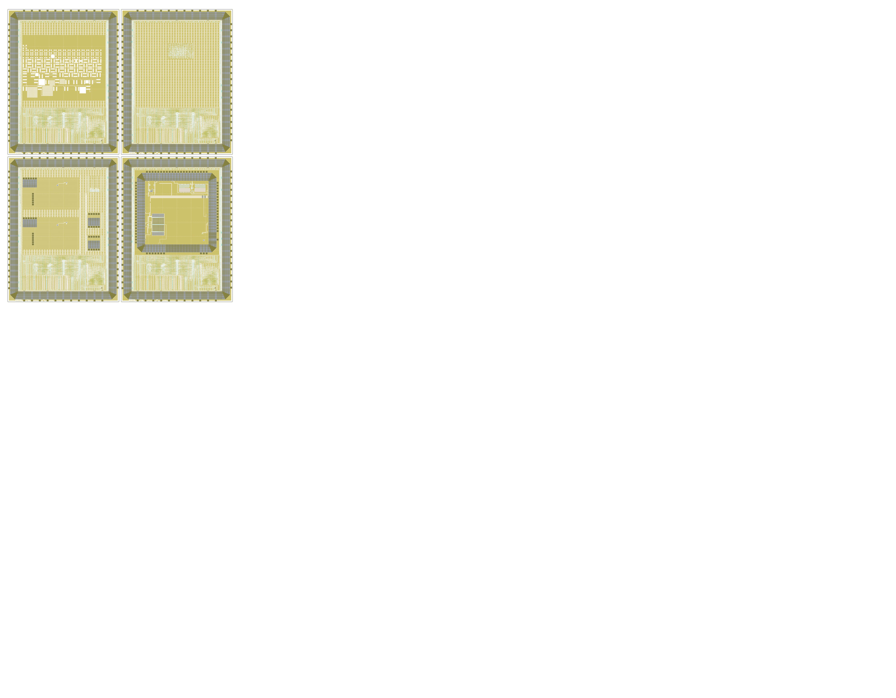

# Google / Efabless MPW-18H1

[Google](https://opensource.google/) & [Efabless](https://efabless.com/) GF180MCU micro-shuttle MPW-18H1

- Shuttle ID: GFMPW18H1
- Process: GF180MCU
- Number of slots: 4

<table width="100%">
  <tr>
  <td width="50%"></td>
  <td width="50%"></td>
  </tr>
</table>

This shuttle was not run by wafer.space. See [PROVENANCE.md](PROVENANCE.md) for where the layouts come from and how this repository was generated.

# Public Projects

| Code | Project | Slot Size | Project Details | Repository |
|---|---|---|---|---|
| 0001 | PG standard cells test | 1x1 | GF180MCU test structures. By Philipp Gühring. | https://github.com/thesourcerer8/gf180teststructure |
| 0002 | OSU 3.3V standard cell test (vlsiffra adder) | 1x1 | 32-bit adder using Anton Blanchard's vlsiffra architecture with the OSU gf180mcuC 3.3V standard cells. | https://foss-eda-tools.googlesource.com/third_party/shuttle/gf180mcu/mpw-18h1/slot-002 |
| 0003 | Fitbit test IC 1 | 1x1 |  | https://foss-eda-tools.googlesource.com/third_party/shuttle/gf180mcu/mpw-18h1/slot-003 |
| 0004 | OpenFASoC sensor harness | 1x1 | OpenFASoC sensor harness. | https://foss-eda-tools.googlesource.com/third_party/shuttle/gf180mcu/mpw-18h1/slot-004 |

# View the Reticle Layout

1. To view the reticle layout, please install [KLayout](https://www.klayout.de/).
2. Next, assemble `GFMPW18H1.oas` from the individual files: `cd layout; cat GFMPW18H1-part-?? >GFMPW18H1.oas`
3. The assembled `GFMPW18H1.oas` file can then be opened with KLayout.
4. Finally, load the layer properties file in KLayout: "File → Load Layer Properties" and choose `lyp/gf180mcu.lyp`.

Note: The `GFMPW18H1.oas` file was split with `split -b 90M GFMPW18H1.oas GFMPW18H1-part-`

# License

The projects shown here are public. For information on licences, please refer to the individual repositories.
